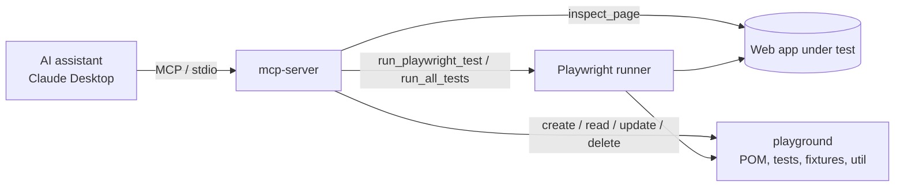

# Playwright MCP CoE

[](https://github.com/<your-username>/<your-repo>/actions/workflows/playwright.yml)

A Playwright + TypeScript test framework with a **Model Context Protocol (MCP) server** that lets an AI assistant
(for example Claude) inspect pages, write page objects and tests, and run them, using the framework's own conventions.

| Folder | What it is |
|---|---|
| [`playground/`](playground) | The test framework: Page Object Model, fixtures, API-assisted login, CI-ready config. See its [README](playground/README.md). |
| [`mcp-server/`](mcp-server) | The MCP server that exposes the framework to an AI assistant. |

## How it fits together



## MCP tools

| Tool | What it does |
|---|---|
| `inspect_page` | Opens a page (http/https only) and returns headings, forms, inputs, buttons, links and locator suggestions |
| `read_framework_file` | Reads a file inside the framework folder |
| `create_framework_file` | Creates a TypeScript file in the right folder by type: `test`, `page`, `util`, `fixture`, `api` (never overwrites) |
| `update_framework_file` | Writes a file inside the framework folder |
| `delete_framework_file` | Deletes files (not folders); config files, `node_modules`, `.git` and `.env` files are protected |
| `list_tests` | Lists every test Playwright can find |
| `run_playwright_test` | Runs one spec file, optionally filtered by tag or title, headless by default |
| `run_all_tests` | Runs the whole suite, optionally filtered by tag or title |
| `hello` | Connectivity check |

All file tools are confined to the framework folder, and test runs use argument arrays, never a shell string.

## Example prompts

- "Inspect https://example.com/login and create a page object for it."
- "Write a test for the invalid-password case using the existing `LoginPage`, then run it."
- "Run all `@smoke` tests and summarise any failures."
- "List the tests, then tell me which page objects have no tests yet."

## Quick start

```bash
# 1. Framework
cd playground
npm install
npm run install:browsers
cp .env.example .env        # Windows: copy .env.example .env
npm test

# 2. MCP server
cd ../mcp-server
npm install
```

Register the server in Claude Desktop (`claude_desktop_config.json`). Use your own absolute path to `server.ts`:

```json
{
  "mcpServers": {
    "my-framework": {
      "command": "npx",
      "args": ["--yes", "tsx", "/absolute/path/to/mcp-server/server.ts"]
    }
  }
}
```

By default the server works on the sibling `playground/` folder. Override it with the `FRAMEWORK_PATH` environment
variable, and adjust the test timeout (default 180 s) with `TEST_TIMEOUT_MS`.

## Notes

- The default target is the public [OrangeHRM demo](https://opensource-demo.orangehrmlive.com). It is shared, its data can
  change and it can be slow, so point `BASE_URL` at your own environment for reliable runs. The security tests send injection
  payloads, so only run them against systems you are allowed to test.
- Never commit `.env` files. Use CI secrets for real credentials.

## License

[ISC](LICENSE)
